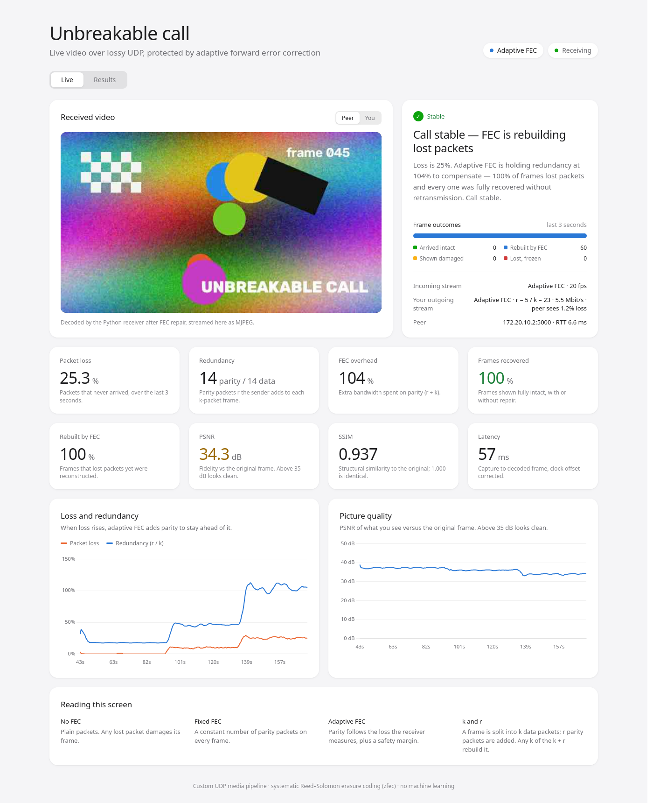
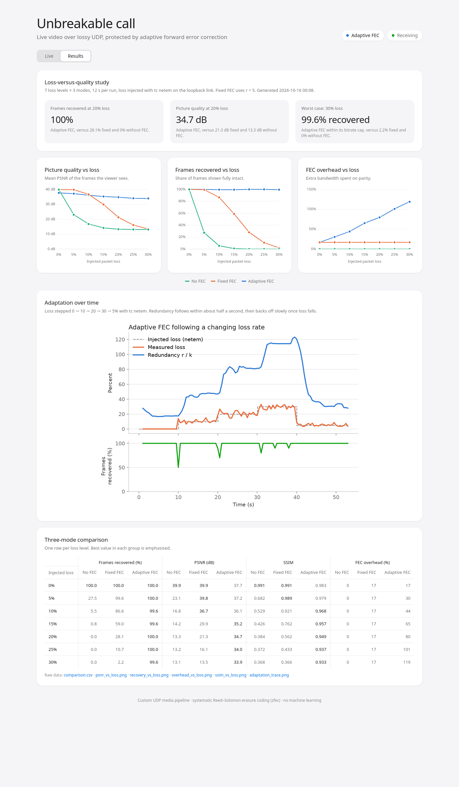

# Unbreakable call: project report

**Course:** Computer Networks · **Repository:** https://github.com/AmeerDeen08/cn_project_videocall

## 1. Objective

Build a video-calling application that keeps the picture intact under heavy
packet loss. It does this with **forward error correction (FEC)**: each video
frame is sent with extra parity packets, so the receiver can rebuild lost
data without asking for a retransmission. The novel part is that the amount
of parity **adapts in real time to the loss the receiver measures**.

The project has four parts:

1. A working two-way video call over UDP between two machines, Linux and
   macOS, running one cross-platform codebase.
2. Three FEC modes to compare: **no FEC**, **fixed FEC** and **adaptive FEC**.
3. A live web dashboard that shows the call, its metrics and a plain-language
   explanation of what is happening.
4. A measured loss-versus-quality study of the three modes.

No machine learning is used anywhere.

## 2. Design

The app uses a custom UDP media pipeline written in Python, rather than
WebRTC. WebRTC has its own internal FEC, which would hide the effect being
studied. Here every packet, parity decision and loss event is controlled and
measured.

```
 Peer A                                         Peer B
 camera/file → JPEG → FEC encode (k + r) ── UDP media ──► reassemble → FEC decode → display
 adaptive controller ◄──────────────────── UDP control ── loss estimator (sliding window)
 (and the same pipeline in the opposite direction)
```

| Concept | How it is implemented |
|---|---|
| Erasure code | Each JPEG frame is split into `k` chunks of 1200 bytes. `zfec`, a systematic Reed–Solomon code, adds `r` parity chunks. **Any `k` of the `k + r` chunks rebuild the frame.** |
| Packet header | 32 bytes: `frame_id`, `chunk_index`, `k`, `total_chunks`, `r`, `frame_len` and `send_timestamp`. These are used for reassembly, loss measurement and latency. |
| Loss measurement | The receiver counts chunks sent against chunks received over the last 40 frames, and reports to the sender every 5 frames. |
| Adaptive rule | The sender smooths the reported loss: it rises fast and falls slowly. It adds a 3% margin to get `p`, then picks the smallest `r` such that `P[Binomial(k + r, p) ≤ r] ≥ 99.5%`. |
| Bitrate budget | Data plus parity stays under 6 Mbit/s. When more parity is needed, JPEG quality is lowered instead of sending more data (see section 5). |
| Quality metrics | PSNR and SSIM of **the frame the viewer actually sees**, compared with the original frame of the shared test clip. |

## 3. Steps carried out

| # | Step | Output |
|---|---|---|
| 1 | Built the UDP media pipeline: capture, JPEG, packetisation, reassembly and playout deadline | `peer.py`, `codec.py`, `packet.py` |
| 2 | Added packet-level erasure coding (`zfec`, with a `reedsolo` fallback) | `fec.py` |
| 3 | Added the loss estimator, the feedback channel and the adaptive redundancy controller | `adaptive.py` |
| 4 | Added per-frame metrics: loss, recovery, PSNR, SSIM, overhead and clock-corrected latency | `metrics.py`, `logs/peer_<port>.csv` |
| 5 | Built the live web dashboard: MJPEG video, WebSocket stats, live charts, a plain-language explainer, and light and dark themes | `dashboard/` |
| 6 | Wrote a loss-injection tool using `tc netem`, scoped to the call's UDP ports | `impair.sh` |
| 7 | Tested on one Linux machine over loopback, comparing no FEC and adaptive FEC under 20–25% loss | `docs/screenshots/live_*.png` |
| 8 | Ran the evaluation: 7 loss levels × 3 modes, plus an adaptation trace | `evaluate.py`, `results/` |
| 9 | Added launchers for the two-laptop demo and a macOS setup check | `start.sh`, `demo.sh`, `mac_setup.sh`, `DEMO.md` |
| 10 | Ran the two-laptop test over a phone hotspot. Fixed a one-way-call problem caused by a wrong peer IP, and a congestion collapse | commits `96fe383` and `f8751be` |
| 11 | Re-ran the study with the final design and captured the two-laptop dashboard under injected loss | `results/`, `docs/screenshots/two_laptops_*.png` |

## 4. Outputs

### 4.1 Live call between two laptops (Linux ↔ macOS over a phone hotspot)

Each screenshot is the Mac's live dashboard. The Linux laptop injected loss
with `tc netem` on the traffic it sent to the Mac.

| Screenshot | Injected loss | Measured loss | Redundancy `r / k` | Frames recovered | PSNR | SSIM | Latency |
|---|---|---|---|---|---|---|---|
| `docs/screenshots/two_laptops_0pct_loss.png` | 0% | 0.0% | 4 / 22 (18%) | 100% | 37.6 dB | — | — |
| `docs/screenshots/two_laptops_10pct_loss.png` | 10% | 10.2% | 9 / 20 (47%) | 100% (90% rebuilt by FEC) | 36.4 dB | 0.969 | 19 ms |
| `docs/screenshots/two_laptops_25pct_loss.png` | 25% | 25.3% | 14 / 14 (104%) | 100% (100% rebuilt by FEC) | 34.3 dB | 0.937 | 57 ms |

Each value was read from the dashboard when its screenshot was taken. The
0% row came from the dashboard's stats feed, which does not include SSIM or
latency.



### 4.2 Single machine, failure case versus adaptive FEC

| Screenshot | What it shows |
|---|---|
| `docs/screenshots/live_nofec_20pct_loss.png` | **No FEC** at 20% loss: 0% of frames recovered, PSNR 14.4 dB. The video breaks into corrupted blocks and the explainer reads "Video is breaking up". |
| `docs/screenshots/live_adaptive_25pct_loss.png` | **Adaptive FEC** at 25% loss: 100% of frames recovered. The loss/redundancy chart shows redundancy stepping up as loss rises from 0 to 10 to 25%. This was taken before the bitrate budget was added, so it shows the uncapped version: 85% overhead, 39.9 dB. |

### 4.3 Evaluation study (`python evaluate.py`, tc netem on loopback)

Each mode ran at each loss level for 12 seconds, about 240 frames. Fixed FEC
used `r = 5`. Adaptive FEC used the 6 Mbit/s budget.

| Injected loss | Frames recovered: No / Fixed / **Adaptive** (%) | PSNR: No / Fixed / **Adaptive** (dB) | FEC overhead: Fixed / **Adaptive** (%) |
|---:|:---:|:---:|:---:|
| 0%  | 100 / 100 / **100** | 39.9 / 39.9 / **37.7** | 17 / **17** |
| 5%  | 27.5 / 99.6 / **100** | 23.1 / 39.8 / **37.2** | 17 / **30** |
| 10% | 5.5 / 86.6 / **99.6** | 16.8 / 36.7 / **36.1** | 17 / **44** |
| 15% | 0.9 / 59.1 / **99.6** | 14.2 / 29.9 / **35.2** | 17 / **65** |
| 20% | 0 / 28.1 / **100** | 13.3 / 21.3 / **34.7** | 17 / **80** |
| 25% | 0 / 10.7 / **100** | 13.2 / 16.1 / **34.0** | 17 / **101** |
| 30% | 0 / 2.2 / **99.6** | 13.1 / 13.5 / **33.9** | 17 / **119** |

| Output file | Contents |
|---|---|
| `docs/screenshots/results_light.png` | The dashboard's Results tab in light mode: headline cards, three charts, adaptation trace and three-mode table |
| `docs/screenshots/results_dark.png` | The same view in dark mode |
| `results/psnr_vs_loss.png` | Picture quality vs packet loss, all three modes |
| `results/recovery_vs_loss.png` | Frames recovered vs packet loss |
| `results/overhead_vs_loss.png` | FEC bandwidth overhead vs packet loss |
| `results/ssim_vs_loss.png` | Structural similarity vs packet loss |
| `results/adaptation_trace.png` | Adaptive FEC following a 0 → 10 → 20 → 30 → 5% loss step pattern over time |
| `results/comparison.csv` | All numbers above, one row per loss level and mode |
| `results/summary.json` | The same data, as loaded by the dashboard's Results tab |



## 5. Findings

1. **Without FEC, a lost packet ruins its frame.** A frame is about 29
   packets, so even 5% loss leaves only about 0.95²⁹ ≈ 23% of frames whole,
   and 27.5% were measured. At 15% loss and above, almost nothing arrives
   intact.
2. **Fixed FEC has a hard ceiling.** Five parity packets give the best
   picture up to about 5% loss. Beyond what they can cover, recovery falls
   from 87% at 10% loss to 2% at 30% loss.
3. **Adaptive FEC kept 99.6–100% of frames at every level up to 30% loss.**
   PSNR fell gently, from 37.7 to 33.9 dB, instead of collapsing to 13 dB.
   The same behaviour held between two real laptops over Wi-Fi (section 4.1).
4. **Reaction time is about half a second.** `results/adaptation_trace.png`
   shows a brief recovery dip each time loss steps up abruptly. This is the
   time for the loss report to travel back and for the estimate to rise.
5. **The two-laptop test found a real flaw, and it was fixed.** On the phone
   hotspot, loss caused by congestion made the controller add parity, which
   added traffic and caused more loss. Redundancy locked at 150% while loss
   reached 79%. This positive feedback loop is a known risk of FEC on
   congested links. The fix is a **bitrate budget**: extra protection is now
   paid for with JPEG quality instead of bandwidth, so the send rate stays
   bounded. After the fix, the same link handled 25% injected loss with 100%
   frame recovery.
6. **What the budget costs.** On a clean link, adaptive FEC gives about
   2 dB lower PSNR than fixed FEC (37.7 vs 39.9 dB), because part of the
   budget is reserved for parity.

## 6. Limitations

* The loss model is independent random loss (`netem loss X%`). Long bursts,
  where several consecutive frames are lost, are only partly covered by
  per-frame FEC.
* PSNR and SSIM need the shared test clip (`--mode file`). For webcam calls,
  only loss, recovery and latency are measured.
* `tc netem` only shapes outgoing traffic. In the two-laptop setup, loss was
  injected on Linux → Mac traffic, so the Mac's dashboard shows its effect.

## 7. How to reproduce

```bash
pip install -r requirements.txt
./run_local.sh adaptive                      # one machine; dashboard at http://127.0.0.1:8080
sudo ./impair.sh add lo --loss 20            # inject loss (Linux)
python evaluate.py                           # full study → results/
./start.sh                                   # two laptops (see DEMO.md)
```

`README.md` has the full instructions, and `DEMO.md` is the two-laptop demo
runbook.
