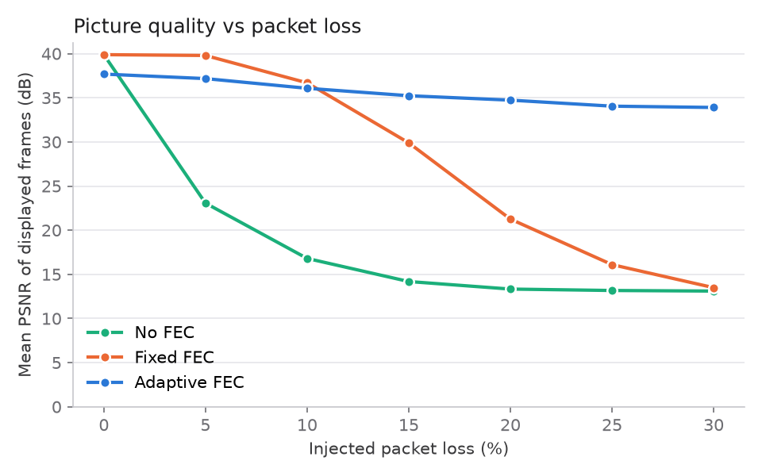
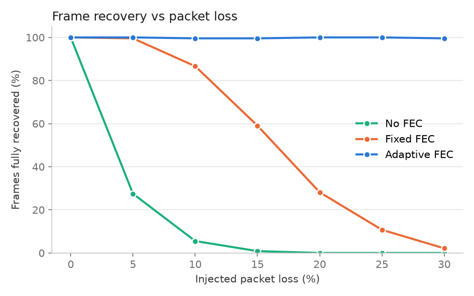
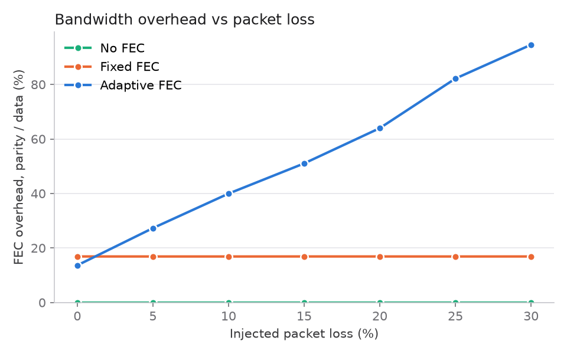
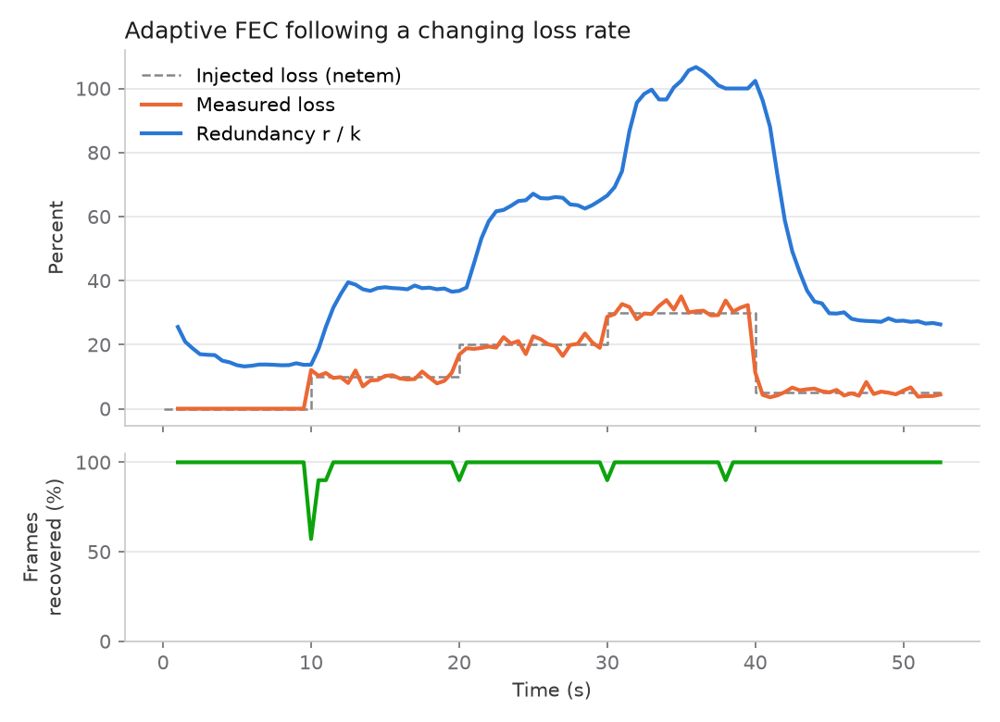

# Unbreakable call: adaptive FEC video calling over UDP

> The project report, with the objective, steps, results and screenshot
> index, is in [PROJECT_REPORT.md](PROJECT_REPORT.md). The two-laptop demo
> runbook is in [DEMO.md](DEMO.md).

A video-calling app that keeps working under heavy packet loss. Each frame is
sent with **forward error correction** (FEC): extra parity packets let the
receiver rebuild lost data without asking for a retransmission. The amount of
parity **adapts in real time** to the loss the receiver measures.

The app runs on a custom UDP media pipeline, written in Python, rather than on
WebRTC, so the FEC can be fully controlled and measured. A live web dashboard
shows the call and explains in plain language what it is doing. An evaluation
harness compares three modes: **no FEC**, **fixed FEC** and **adaptive FEC**.
No machine learning is used anywhere.

## Architecture

```
          Peer A  (Linux)                                   Peer B  (macOS / Linux)
 ┌──────────────────────────────┐                   ┌──────────────────────────────┐
 │ capture ─► JPEG ─► FEC encode │── UDP media ────►│ reassemble ─► FEC decode      │
 │  (webcam / file)   k + r      │   port 6000       │   any k of k+r ─► JPEG decode │
 │                    chunks     │                   │        │                      │
 │ adaptive controller ◄─────────│◄─ UDP control ────│ loss estimator (sliding win.) │
 │   picks r from reported loss  │   port 6001       │        │                      │
 │                               │                   │        ▼                      │
 │ reassemble ─► FEC decode ◄────│◄─ UDP media ──────│ OpenCV window + metrics CSV   │
 │      │                        │   port 5000       │                               │
 │      ▼                        │                   │ (B sends its own video back   │
 │ OpenCV window, metrics CSV,   │── UDP control ──► │  over the same pipeline)      │
 │ web dashboard :8080           │   port 5001       │                               │
 └──────────────────────────────┘                   └──────────────────────────────┘
```

Both peers run the same program, `peer.py`, and the call is fully
bidirectional. Each peer runs four concurrent loops:

| Loop | What it does |
|---|---|
| send | capture → JPEG (`codec.py`) → split into `k` chunks → add `r` parity chunks (`fec.py`) → one UDP packet per chunk |
| receive | collect chunks per frame → rebuild from any `k` → decode → display; finalise each frame after a 120 ms playout deadline |
| control | send loss reports to the peer every 5 frames; receive the peer's reports and feed the adaptive controller; ping/pong to estimate RTT and clock offset |
| UI | native OpenCV window (main thread); optional Flask dashboard (`--dashboard`) |

### Files

| File | Purpose |
|---|---|
| `peer.py` | The application: sockets, send/receive/control loops, OpenCV window |
| `packet.py` | Wire formats: 32-byte binary media header and JSON control messages |
| `codec.py` | Webcam and file capture, JPEG encode/decode, decoding of damaged frames |
| `fec.py` | Systematic Reed–Solomon packet erasure coding (`zfec`, with a `reedsolo` fallback) |
| `adaptive.py` | Receiver loss estimator and sender redundancy controller |
| `metrics.py` | Per-frame CSV log, PSNR/SSIM, live stats used by the dashboard |
| `dashboard/` | Flask server (MJPEG video, WebSocket stats, results) and the single-page frontend |
| `impair.sh` | `tc netem` wrapper that adds, changes or clears loss, delay and jitter (Linux only) |
| `evaluate.py` | Loss sweep across the three modes, producing CSV, graphs and `summary.json` |
| `make_sample.py` | Generates `samples/sample.mp4`, the deterministic test clip |
| `run_local.sh` | Starts a two-peer call on one machine |

### Packet format

```
 magic | type | flags | rsv | frame_id (u32) | src_index (u32)
 chunk_index (u16) | k (u16) | total_chunks (u16) | redundancy r (u16)
 frame_len (u32) | send_timestamp (f64)  | payload: one 1200-byte chunk
```

The `flags` byte carries the sender's FEC mode. The receiver uses `frame_id`,
`chunk_index`, `k` and `total_chunks` for reassembly and loss measurement, and
`send_timestamp` for latency, after correcting for the clock offset estimated
NTP-style over the control channel.

## Install

You need Python 3.11 or newer (tested on 3.14).

```bash
python3 -m venv venv
source venv/bin/activate
pip install -r requirements.txt
python make_sample.py        # only if samples/sample.mp4 is missing
```

## Single-machine test (Linux)

The quickest way to start a call on one machine:

```bash
./run_local.sh adaptive      # or: off | fixed
```

Or start the two peers yourself in two terminals:

```bash
# terminal 1: peer B
python peer.py --mode file --fec adaptive --listen-port 6000 --peer-port 5000

# terminal 2: peer A, with the dashboard
python peer.py --mode file --fec adaptive --listen-port 5000 --peer-port 6000 --dashboard
```

To see the dashboard, open **http://127.0.0.1:8080** in a browser.

Now add packet loss. On `lo`, `impair.sh` only affects the call's UDP ports
(5000, 5001, 6000 and 6001), so the dashboard, DNS and other loopback traffic
are not touched:

```bash
sudo ./impair.sh add lo --loss 20                      # 20% random loss
sudo ./impair.sh change lo --loss 30 --delay 40 --jitter 10
./impair.sh show lo
sudo ./impair.sh clear lo
```

What you should see at 20% loss:

* With **`--fec off`**, the video breaks up into corrupted blocks and freezes.
  The explainer turns red ("Video is breaking up") and frame recovery drops
  to almost 0%.
* With **`--fec adaptive`**, the video stays intact. The blue redundancy line
  on the "Loss and redundancy" chart rises to match the orange loss line, and
  the explainer says the call is stable.

If you can't use `tc`, for example on macOS, use `--sim-loss 20` on both peers
instead. The peers then drop that share of their outgoing packets themselves,
using the same random-loss model.

## Two-machine call (Linux + macOS)

1. Connect both machines to the same network and find each one's IP address
   (`ip -4 addr` on Linux, `ipconfig getifaddr en0` on macOS).
2. On the Linux machine, which runs the dashboard:
   ```bash
   python peer.py --mode webcam --fec adaptive \
     --listen-port 5000 --peer-ip <MAC_IP> --peer-port 6000 --dashboard
   ```
3. On the Mac:
   ```bash
   python peer.py --mode webcam --fec adaptive \
     --listen-port 6000 --peer-ip <LINUX_IP> --peer-port 5000
   ```
4. Open http://127.0.0.1:8080 on the Linux machine. To show the dashboard on
   another device, add `--dashboard-host 0.0.0.0`.
5. Add loss on the Linux machine's real interface. This affects what Linux
   sends to the Mac, and so the Mac's view and the feedback it returns:
   ```bash
   # use your interface name; --ports keeps the rest of the machine's traffic clean
   sudo ./impair.sh add wlo1 --loss 20 --ports 6000,6001
   sudo ./impair.sh clear wlo1
   ```
   To degrade the video that Linux receives, which is what the dashboard
   shows, start the **Mac** peer with `--sim-loss 20`.

To get PSNR and SSIM ground truth across machines, use `--mode file` on both
sides, since both then play the same `samples/sample.mp4`.

The call uses UDP ports 5000–5001 (Linux) and 6000–6001 (Mac). The first
time the Mac runs it, macOS asks for camera access and may ask whether Python
can accept incoming network connections. Allow both.

## How the adaptive FEC works

1. **Erasure coding.** Each JPEG frame is split into `k` data chunks of 1200
   bytes. `zfec` adds `r` parity chunks using a systematic Reed–Solomon code.
   Because the code is MDS, **any `k` of the `k + r` chunks rebuild the
   frame**. Because it is systematic, a frame with no losses needs no decoding.
2. **Measuring loss (receiver).** Each frame is finalised once all its chunks
   have arrived, once a later frame overtakes it, or once 120 ms have passed.
   The receiver logs how many chunks were sent (`total_chunks`, from the
   header) and how many arrived. Frames that vanish completely are found from
   gaps in `frame_id`. Loss over a sliding window of the last 40 frames is
   reported to the sender every 5 frames, with a 1-second heartbeat.
3. **Choosing redundancy (sender).** The sender smooths the reported loss
   with an asymmetric moving average: it reacts quickly when loss rises
   (α = 0.6) and relaxes slowly when loss falls (α = 0.15). It then adds a 3%
   safety margin to get `p`. For each frame it picks the smallest `r` that
   satisfies

   ```
   P[ Binomial(k + r, p) ≤ r ]  ≥  0.995
   ```

   This is the chance that no more than `r` of the frame's packets are lost,
   assuming independent loss. `r` is clamped to `[1, 1.5·k]`. For example,
   with `k = 25`, measured loss of 0%, 5%, 10%, 20% and 30% gives
   `r` = 4, 7, 10, 17 and 25.
4. **Bitrate budget.** Adaptive FEC keeps data + parity under `--max-kbps`
   (default 6000 kbit/s). When a frame plus its parity would exceed it, the
   frame is re-encoded at a lower JPEG quality, down to q25. When there is
   room again, quality creeps back up. Without the cap, loss caused by
   congestion feeds on itself: more loss leads to more parity, which leads to
   more traffic and more loss. We saw exactly this on a phone hotspot, where
   redundancy locked at its 150% ceiling with 79% loss. With the cap, extra
   protection costs picture sharpness instead of bandwidth.
5. **Fixed FEC** always sends `--fixed-redundancy` parity chunks (default 5,
   about 17% for this clip). It is wasteful on a clean link and overwhelmed
   by heavy loss. **No FEC** sends only the data chunks, so a single lost
   packet damages the frame.

When a frame can't be rebuilt, the receiver fills the holes with zeros. JPEG
restart markers let the decoder resynchronise, so the viewer sees localised
corruption. If nothing usable arrived, the previous frame stays frozen.

## Metrics

Each peer writes one CSV row per received frame to `logs/peer_<port>.csv`
(override with `--metrics-csv`). The same rows feed the dashboard's live stats.

| Field | Meaning |
|---|---|
| `loss_pct` | Share of the frame's chunks that never arrived |
| `outcome` | `intact`, `rescued` (rebuilt by FEC), `damaged` (shown corrupted) or `lost` (frozen) |
| `recovered` | 1 if the frame was shown fully intact (`intact` or `rescued`) |
| `overhead_pct` | `r / k`, the extra bandwidth spent on parity |
| `psnr`, `ssim` | Quality of **what the viewer sees** in that slot, compared with the original clip frame, on luma; SSIM is computed at half resolution |
| `latency_ms` | Time from capture to decoded frame, clock-offset corrected |

PSNR and SSIM need ground truth, so they are only computed when the sender
uses `--mode file`. Frame `i` of the stream is always clip frame
`i mod clip_length`, so the receiver knows the original even for frames that
were lost.

## Evaluation

```bash
python evaluate.py                 # tc netem on lo; asks for sudo once
python evaluate.py --impair sim    # no root: in-app packet dropping
python evaluate.py --replot        # rebuild graphs from existing runs
```

The script sweeps loss through 0, 5, 10, 15, 20, 25 and 30%. Each mode runs
for 3 s of warm-up plus 12 s of measurement at every level. It writes the
following files to `results/`:

* `comparison.csv` and `summary.json`: one row per loss level and mode
* `psnr_vs_loss.png`, `recovery_vs_loss.png`, `overhead_vs_loss.png` and
  `ssim_vs_loss.png`
* `adaptation_trace.png`: adaptive FEC following a 0 → 10 → 20 → 30 → 5% loss
  step pattern

To see the charts and the three-mode table, open the dashboard's **Results**
tab.

### Results on this machine (tc netem on loopback)

Each cell covers 12 s, about 240 frames of a 640×360 clip at 20 fps.
Fixed FEC used `r = 5`. Adaptive FEC used the default 6000 kbit/s budget.

| Injected loss | Frames recovered (No / Fixed / **Adaptive**) | Mean PSNR, dB (No / Fixed / **Adaptive**) | FEC overhead (Fixed / **Adaptive**) |
|---:|:---:|:---:|:---:|
| 0%  | 100 / 100 / **100** % | 39.9 / 39.9 / **37.7** | 17 / **17** % |
| 5%  | 27.5 / 99.6 / **100** % | 23.1 / 39.8 / **37.2** | 17 / **30** % |
| 10% | 5.5 / 86.6 / **99.6** % | 16.8 / 36.7 / **36.1** | 17 / **44** % |
| 15% | 0.9 / 59.1 / **99.6** % | 14.2 / 29.9 / **35.2** | 17 / **65** % |
| 20% | 0 / 28.1 / **100** % | 13.3 / 21.3 / **34.7** | 17 / **80** % |
| 25% | 0 / 10.7 / **100** % | 13.2 / 16.1 / **34.0** | 17 / **101** % |
| 30% | 0 / 2.2 / **99.6** % | 13.1 / 13.5 / **33.9** | 17 / **119** % |

What the results show:

* **No FEC** falls apart almost immediately. A frame is about 29 packets, so
  even at 5% loss only about 0.95²⁹ ≈ 23% of frames arrive whole.
* **Fixed FEC** works at low loss but has a hard ceiling. Once loss passes
  what 5 parity packets can cover, recovery falls quickly. At low loss it
  gives the sharpest picture, because it spends nothing extra.
* **Adaptive FEC** recovered 99.6–100% of frames at every level, without
  ever exceeding its bitrate budget. As loss rises, it shifts the budget from
  picture detail to parity: JPEG quality falls, so PSNR declines gently from
  37.7 to 33.9 dB instead of collapsing to 13 dB. The cap costs about 2 dB on
  a clean link compared with fixed FEC. Overhead has to grow faster than
  loss, because parity covers `r / (k + r)` of the packets, not `r / k`, and
  because extra margin is needed for the random variation in how many
  packets each frame loses.
* **Two laptops over a phone hotspot.** Screenshots are in
  `docs/screenshots/two_laptops_*`. With 10% loss injected on the link,
  adaptive FEC rebuilt 90% of frames and showed 100% intact, at 36.4 dB. At
  25% it rebuilt every frame, again 100% intact, at 34.3 dB.
* **Reaction time.** The trace shows a short recovery dip, about half a
  second, each time loss steps up abruptly. That is the time for the loss
  report to travel back and for the smoothed estimate to rise. When loss
  falls, redundancy is reduced more slowly, on purpose.






## `peer.py` options

```
--listen-ip/--listen-port   local UDP media port (control = port + 1)
--peer-ip/--peer-port       remote peer's media port
--mode webcam|file          live camera or looping --source clip
--source PATH               clip for file mode (default samples/sample.mp4)
--fec off|fixed|adaptive    FEC mode; --fixed-redundancy N for fixed
--dashboard                 serve the web dashboard (--dashboard-host/--dashboard-port)
--no-window                 headless
--duration S                exit after S seconds
--sim-loss PCT              drop PCT% of outgoing packets in-app
--fps, --jpeg-quality, --chunk-size, --playout-ms, --feedback-every
```

Press `q` or `Esc` in the call window to quit.
